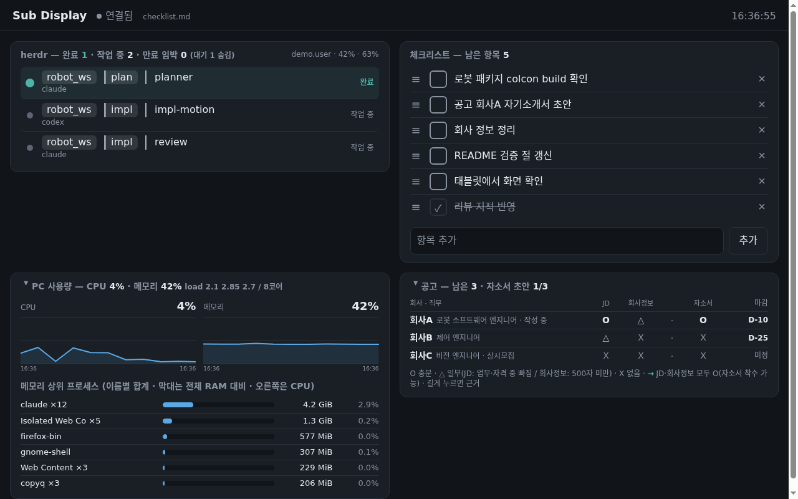
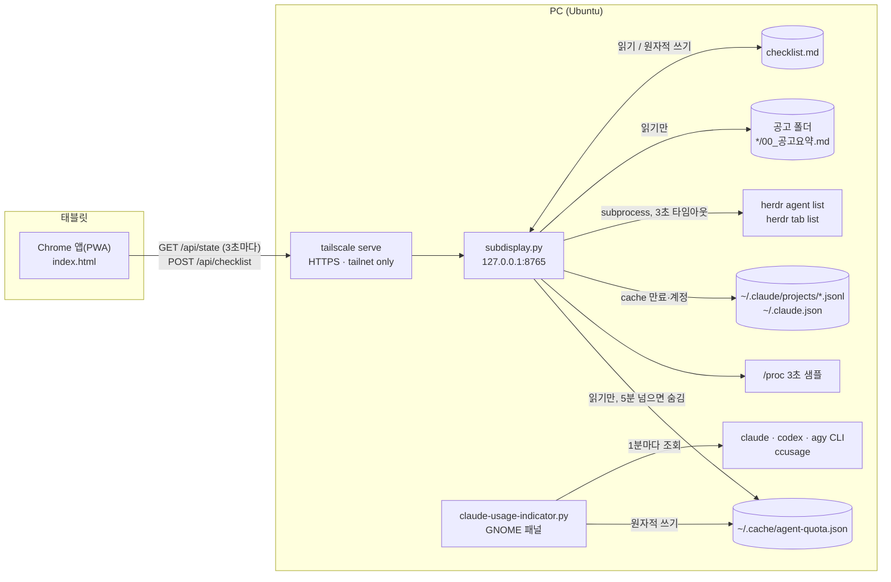

# agent-sidekick-tools

> Small tools for running several coding agents (Claude Code, Codex, Antigravity) in parallel on one Linux PC: a tablet side display for agent status / checklist / PC load / job-posting progress, and a GNOME panel indicator for usage limits. Python standard library + GTK, no database.

코딩 agent 여러 개를 동시에 돌리며 일할 때 쓰려고 만든 개인 도구 두 개입니다. 터미널을 오가지 않고 곁눈으로 상태를 보는 것이 목적입니다.



## 왜 만들었나
herdr 같은 터미널 multiplexer로 agent 세션을 여러 개 띄워 두면, 어느 세션이 끝나서 입력을 기다리는지, 사용량 한도가 얼마나 남았는지, PC가 버거운지를 보려고 계속 창을 오가게 됩니다. 그래서 두 가지를 만들었습니다.

| 도구 | 하는 일 | 핵심 설계 |
|---|---|---|
| [`subdisplay/`](subdisplay/README.md) | 태블릿을 서브 디스플레이로 — agent 상태·체크리스트·PC 사용량·지원 공고 정리 상태를 한 화면에 | DB 없음(md 파일이 원본, Obsidian에서 같이 편집), 줄 내용 비교(`expect`)로 동시 수정 충돌 감지, 표준 라이브러리만, tailnet 안에서만 접속 |
| [`usage-indicator/`](usage-indicator/README.md) | Claude Code·Codex·agy 사용량(5시간·주간 %)과 리셋까지 남은 시간을 GNOME 상단 패널에 | 세 CLI를 병렬 조회, 실패한 서비스 자리만 `err`, 결과를 파일로 남겨 다른 도구가 추가 조회 없이 읽음 |
| [`tok_refresh/`](tok_refresh/README.md) (문서만) | Oracle Cloud VM의 cron이 하루 4번(06·11·16·21시) Claude Code·Codex·agy에 짧은 ping을 보내 5시간 사용량 윈도우를 정해진 시각에 열고, 리셋 시각을 판정해 Discord로 알림 | 리셋을 업무 시간에 맞춰 하루 사용량을 4개 윈도우로 분배, 공식 CLI만 호출(토큰은 각 CLI가 갱신), `flock`·`timeout`·1회 재시도 |

## 구조

- 두 도구는 프로세스로 연결되지 않고 `~/.cache/agent-quota.json` 파일 하나로만 이어집니다. indicator가 꺼져 있으면 subdisplay의 사용량 칸이 비고, 나머지는 그대로 동작합니다.

## 실행
```bash
# subdisplay — 데모 데이터(subdisplay/example/)로 바로 뜬다
python3 subdisplay/subdisplay.py          # http://127.0.0.1:8765
# usage-indicator — GNOME 패널에 표시
python3 usage-indicator/claude-usage-indicator.py
```
요구 사항과 설정은 각 도구 README에 있습니다.

## 시험
```bash
python3 -B subdisplay/test_subdisplay.py                       # OK OK2 OK3 OK4
python3 -B usage-indicator/claude-usage-indicator.py --selftest  # selftest PASS (GTK 없어도 돈다)
# codex-usage.py는 실행할 때마다 포맷 self-check를 먼저 돌린 뒤 실제 조회를 한다
```

## 시험한 환경
Ubuntu 22.04 · Python 3.10 · herdr 0.9.5 · Claude Code 2.1.x · codex-cli 0.167 · 태블릿 1대(Android Chrome).

## 한계
- 공식 API가 아니라 각 CLI의 출력·내부 파일 형식(`claude -p /usage` 문장, Claude Code transcript, herdr JSON)에 기댑니다. CLI가 업데이트되면 조용히 깨질 수 있고, 그때는 해당 파서를 고쳐야 합니다.
- 서버에는 인증이 없습니다. 127.0.0.1에만 열고 외부 접근 제한은 Tailscale에 맡깁니다.
- 한 사람이 한 PC에서 쓰려고 만든 것이라 설정 화면이 없고, 조정값은 코드 상단 상수입니다.

## License
MIT
