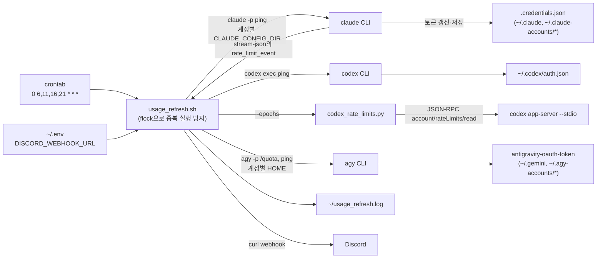
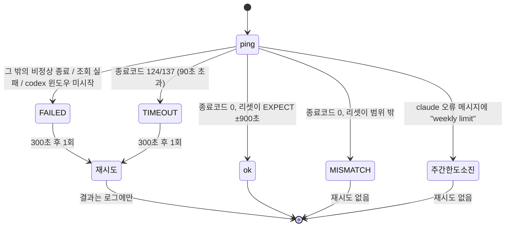

# usage_refresh — AI CLI 사용량 윈도우 예약 트리거

> 작성: 2026-11-04 (KST) · 기준 코드: `~/usage_refresh.sh`, `~/codex_rate_limits.py` (둘 다 2026-10-31 수정본)

하루 네 번(KST 06/11/16/21시) Claude Code, Codex, Antigravity(agy) CLI에 짧은 `ping`을 보내 사용량 윈도우를 정해진 시각에 열고, 리셋 시각이 기대값과 맞는지 판정해 Discord로 알립니다.
만든 이유: 5시간 윈도우는 첫 사용 시점부터 계산되므로, 슬롯 시각에 미리 열어 두면 리셋 시각을 예측할 수 있습니다.

**설계 의도 — 하루 사용량 분배:** 슬롯을 06·11·16·21시에 두면 5시간 윈도우가 06–11, 11–16, 16–21, 21–02시로 끊깁니다. 그래서 5시간 한도가 작업 도중(11·16·21시)에 초기화(refresh)되고, 하루 사용량을 5시간 윈도우 네 개로 나눠 쓸 수 있습니다. 첫 사용 시각에 따라 리셋이 들쭉날쭉해져 한창 작업할 때 한도에 막혀 기다리는 일을 줄이는 것이 목적입니다.

> 이 저장소에는 문서만 있습니다. 코드(`usage_refresh.sh`, `codex_rate_limits.py`)는 Oracle Cloud VM에서 운영 중입니다.

**핵심 설계:** API를 직접 흉내 내지 않고 공식 CLI를 그대로 호출합니다. OAuth 토큰 갱신(refresh)도 각 CLI가 스스로 하며, 스크립트는 토큰 파일을 읽기만 하고 쓰지 않습니다.



## 무엇을 할 수 있나

- 슬롯 시각에 Claude(계정 여러 개), Codex(계정 1개), agy(계정 여러 개)의 사용량 윈도우를 엽니다.
- Claude·Codex: 5시간 리셋 시각이 `슬롯 시작 + 5h` ±15분이면 `ok`, 아니면 `MISMATCH`로 판정합니다.
- agy: 5시간 윈도우가 없고 모델군별 주간 한도만 있습니다. 아직 시작되지 않은 주간 창(리셋 시각이 `조회 시각 + 7일`로 계속 밀리는 창)만 해당 모델로 ping해서 엽니다.
- 회차마다 계정별 결과와 주간 리셋 시각·사용률을 Discord에 한 번 보냅니다.
- `FAILED`/`TIMEOUT`이면 300초 뒤 한 번 재시도합니다. 재시도 결과는 로그에만 남고 Discord로는 보내지 않습니다.

## 시스템 구조

### 실행 순서 (`usage_refresh.sh` 하단)

1. 로그가 1MB를 넘으면 마지막 2000줄만 남깁니다.
2. `~/usage_refresh.lock`에 `flock -n`을 겁니다. 이전 실행이 남아 있으면 `skip`을 기록하고 끝냅니다.
3. 가장 가까운 지난 슬롯을 구해 기대 리셋 시각 `EXPECT`를 계산합니다.
4. Claude 계정마다 `run_claude` 실행: 기본 계정(`~/.claude` + `~/.claude.json`), 그다음 `~/.claude-accounts/*/`.
5. `run_codex`: 직전 5h 윈도우가 200초 안에 끝나면 `리셋 + 20초`까지 기다렸다가 ping합니다. ping 10초 뒤 rate limit을 조회하고, 그 조회 30초 뒤 한 번 더 조회해 리셋 시각이 15초 이상 밀렸으면 "윈도우 미시작"으로 `FAILED` 처리합니다.
6. agy 계정마다 `run_agy`: 기본 `$HOME`, 그다음 `~/.agy-accounts/*/`.
7. `DISCORD_WEBHOOK_URL`이 있으면 결과를 보냅니다.
8. 재시도 대상이 있으면 300초 대기 후 한 번 재시도합니다(로그만). 스크립트 맨 끝 블록이 `CLAUDE_RETRY`에 모인 디렉터리로 `run_claude`를, `RETRY_CODEX=1`이면 `run_codex`를 다시 부릅니다. agy는 재시도하지 않습니다.

### 판정 상태 (Claude·Codex)

`fmt_line`/`is_retryable` 기준입니다. agy는 이 상태를 쓰지 않고 `✅`/`❌ 시작 실패`/`❌ quota 조회 실패`만 있습니다.



CLI가 설치되어 있지 않으면 `skip`(➖)입니다. 주간 한도 소진은 알림에 `주간 한도 소진(<리셋 시각>)`으로 표시됩니다.

모든 CLI 호출에는 `timeout --kill-after=10s 90s`가 걸려 있습니다. 90초가 지나면 종료 신호를 보내고, 그래도 10초 안에 안 끝나면 강제 종료합니다.

### 토큰 갱신이 일어나는 곳

스크립트 자체에는 토큰 갱신 코드가 없습니다. ping을 보낼 때 각 CLI가 만료를 확인하고 필요하면 refresh token으로 갱신해 자기 파일에 다시 씁니다.

| CLI | 토큰 파일 | 계정 분리 방법 | 2026-11-04 08:54 KST 관찰 |
|---|---|---|---|
| claude | `~/.claude/.credentials.json`, `~/.claude-accounts/<이름>/.credentials.json` | `CLAUDE_CONFIG_DIR` | 두 파일 모두 06:00 실행 시각에 다시 써짐. access token 만료는 14:00 KST (약 8시간 수명) |
| codex | `~/.codex/auth.json` (`auth_mode: chatgpt`) | 분리 없음(계정 1개) | `last_refresh` 2026-10-27 16:00 KST. 매 회차 갱신되지는 않음 |
| agy | `<HOME>/.gemini/antigravity-cli/antigravity-oauth-token` | `HOME` 바꿔치기 | 세 파일 모두 06:01 실행 시각에 다시 써짐. 만료는 약 1시간 뒤 |

계정 간에 토큰 파일을 복사하면 안 됩니다. refresh token이 회전(rotation)되어 한쪽 계정이 로그아웃됩니다(스크립트 주석에 적힌 운영 규칙).

## 환경 (실행 PC 기준)

2026-11-04 기준 Oracle Cloud Ubuntu 22.04 계열(커널 6.8.0-oracle), 시간대는 스크립트에서 `TZ=Asia/Seoul`로 고정합니다.

| 의존성 | 위치·버전 (2026-11-04) | 용도 |
|---|---|---|
| claude | `~/.local/bin/claude` 2.1.317 | Claude ping, rate limit 정보 |
| codex | `~/.local/bin/codex` 0.151.0 | Codex ping, `app-server` |
| agy | `~/.local/bin/agy` 1.4.12 | Antigravity `/quota`, ping |
| jq | 1.6 | stream-json 파싱, Discord payload |
| python3 | 3.10.12 (표준 라이브러리만) | `codex_rate_limits.py` |
| flock, timeout, curl, GNU date | util-linux / coreutils / curl 7.81 | 잠금, 시간 제한, 알림, 시각 계산 |

각 CLI는 계정마다 미리 로그인되어 있어야 합니다. Claude는 ping에 `claude-haiku-4-5-20251001` 모델을, agy는 `gemini-3.8-flash-low`(Gemini 계열)와 `gpt-oss-120b-medium`(그 밖의 계열)을 씁니다.

## 파일 구성

| 경로 | 역할 |
|---|---|
| `~/usage_refresh.sh` | 본체. crontab에서 실행 |
| `~/codex_rate_limits.py` | `fetch_rate_limits()`가 `codex app-server --stdio`에 JSON-RPC로 `initialize` → `account/rateLimits/read`를 보내 5h/주간 리셋 시각을 조회(15초 제한). `--epochs` 출력: `<5h리셋epoch> <주간리셋epoch> <주간사용%>`. 인자 없이 실행하면 `primary(5h): N% used, resets ... \| secondary(weekly): ...` 한 줄 |
| `~/.env` | `DISCORD_WEBHOOK_URL` (스크립트가 `source`) |
| `~/usage_refresh.log` | 실행 로그 (CLI 출력 일부 포함) |
| `~/usage_refresh.lock` | `flock` 잠금 파일 (비어 있는 게 정상) |
| `~/.claude-accounts/<이름>/` | 추가 Claude 계정 설정 디렉터리 (2026-11-04: `acct2`) |
| `~/.agy-accounts/<이름>/` | 추가 agy 계정의 가짜 HOME (2026-11-04: `acct2`, `acct3`) |

## 설치

```bash
chmod +x ~/usage_refresh.sh ~/codex_rate_limits.py
echo 'DISCORD_WEBHOOK_URL=https://discord.com/api/webhooks/...' > ~/.env && chmod 600 ~/.env
```

crontab (`crontab -e`):

```
PATH=/home/ubuntu/.local/bin:/usr/local/sbin:/usr/local/bin:/usr/sbin:/usr/bin:/sbin:/bin
0 6,11,16,21 * * * $HOME/usage_refresh.sh
```

cron은 시스템 시간대로 돕니다. 2026-11-04 기준 시스템이 KST라 위 줄이 KST 정각에 실행됩니다.

## 실행

- 자동: 위 crontab.
- 수동: `~/usage_refresh.sh` — 실제 ping을 보내므로 사용량을 쓰고 윈도우를 엽니다. 슬롯 시각이 아닐 때 돌리면 판정이 `MISMATCH`로 나옵니다.
- 재시도 대기 줄이기: `RETRY_DELAY_OVERRIDE=10 ~/usage_refresh.sh`
- Codex 사용량만 보기: `python3 ~/codex_rate_limits.py` (ping 없이 조회만)

### 멈추는 법

1. 예약 중지: `crontab -e`에서 `usage_refresh.sh` 줄을 주석 처리합니다.
2. 실행 중인 회차 중지: `pkill -f usage_refresh.sh`. 이미 떠 있는 `claude`/`codex`/`agy` 자식 프로세스는 각자의 `timeout`(90초, 이후 강제 종료까지 10초)이 지나면 끝납니다. 잠금은 프로세스가 끝나면 풀립니다.

### 자주 겪는 문제

- **`FAILED: You've hit your 5-hour limit`**: 슬롯 밖에서 그 계정을 써서 이전 윈도우가 아직 남은 경우입니다. 300초 뒤 재시도도 리셋 전이면 같은 결과입니다(2026-11-04 06:00 회차 계정 B, 리셋 07:00).
- **Codex `MISMATCH(리셋 HH:MM, 기대 HH:MM)`**: 슬롯 밖 사용으로 윈도우가 이미 열려 있어 ping이 그 윈도우에 들어간 경우입니다. 재시도하지 않습니다(2026-11-04 06:00 회차, 리셋 09:36).
- **Claude 계정이 로그아웃됨**: 다른 계정 디렉터리로 `.credentials.json`을 복사했을 가능성이 큽니다. 해당 디렉터리에서 다시 `/login` 하세요.
- **미로그인 계정**: 토큰 파일이 없으면 그 계정은 조용히 건너뜁니다(로그인 대기로 멈추는 것을 막기 위함). 알림에 계정 줄이 빠졌다면 로그인 여부를 확인하세요.
- **codex 경고 `could not find bubblewrap`**: 로그에 찍히지만 ping 자체는 성공합니다(2026-11-04 확인).

## 검증

로그에서 회차별 결과 줄만 보기:

```bash
grep -E 'refresh start| ok | MISMATCH| FAILED| TIMEOUT|retry' ~/usage_refresh.log | tail -20
```

정상 회차는 `refresh start` 뒤에 계정마다 `ok (expect=<epoch> claude5h=<같은 epoch> ...)`가 나옵니다. 2026-11-03 네 회차는 모든 Claude·Codex 계정이 `ok`였습니다.

토큰 파일이 회차마다 갱신되는지 보려면 수정 시각을 확인합니다(내용은 출력하지 마세요):

```bash
stat -c '%y %n' ~/.claude/.credentials.json ~/.claude-accounts/*/.credentials.json \
  ~/.codex/auth.json ~/.gemini/antigravity-cli/antigravity-oauth-token \
  ~/.agy-accounts/*/.gemini/antigravity-cli/antigravity-oauth-token
```

## 한계·미완성

- **5시간 한도 소진도 재시도 대상**: `FAILED`로 분류되어 300초 뒤 재시도하지만, 리셋 시각 전이면 같은 실패가 반복됩니다. 리셋 시각까지 기다리는 처리가 없습니다.
- **Codex `MISMATCH`는 복구하지 않음**: 이미 열린 윈도우를 바꿀 방법이 없어 알림만 보냅니다.
- **Codex는 계정 1개만 지원**: Claude·agy와 달리 계정별 디렉터리 순회가 없습니다.
- **재시도 결과는 Discord로 가지 않음**: 재시도로 복구됐는지는 로그를 봐야 압니다.
- **agy 판정은 휴리스틱**: "리셋 시각 ≥ 조회 시각 + 7일 − 2초"이면 미시작 창으로 봅니다. agy가 이 동작을 바꾸면 판정이 틀어집니다.
- **`codex_rate_limits.py`는 비공식 경로**: codex TUI가 내부에서 쓰는 `app-server` JSON-RPC를 호출합니다. codex 업데이트로 메서드 이름이 바뀌면 조회가 실패합니다.
- **Discord 전송 실패는 판정에 반영되지 않음**: `curl` 오류는 로그에만 남습니다.

### 확인하지 않은 것

- 각 CLI가 정확히 언제 토큰을 갱신하는지(만료 몇 분 전인지 등)는 CLI 내부 동작이라 코드로 확인하지 않았습니다. 위 표는 파일 수정 시각과 만료 필드로 관찰한 결과입니다.
- Codex `auth.json`이 매 회차 갱신되지 않는 이유(갱신 주기)는 확인하지 않았습니다.

## 실행 PC 관련 메모

- 로그에는 CLI 출력 앞부분(줄당 400자)이 남습니다. 토큰은 남지 않지만, 공유 전에 내용을 확인하세요.

## 더 읽을 문서

- `usage_refresh.sh` 안의 한국어 주석 — 각 대기 시간(20초, 10초, 30초)을 둔 이유가 적혀 있습니다.
- `codex_rate_limits.py` 상단 docstring — app-server를 쓰는 이유.
