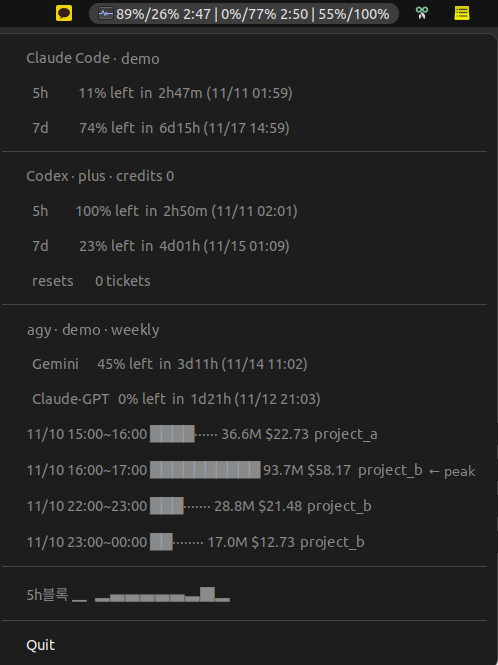

# usage-indicator

Claude Code·Codex·agy(Antigravity CLI) 사용량을 GNOME 상단 패널(AppIndicator)에 띄우는 트레이 앱(`claude-usage-indicator.py`)과, Codex 사용량을 터미널에 한 번 찍는 스크립트(`codex-usage.py`)입니다.



## 실행
```bash
python3 claude-usage-indicator.py              # 패널에 띄움. 종료는 메뉴 맨 아래 Quit
python3 claude-usage-indicator.py --selftest   # 로직 시험만(패널 안 띄움, GTK 없어도 됨)
python3 codex-usage.py                         # Codex 5h/7d 잔여·plan·credits 출력
```
조회 실패는 띄운 터미널의 stderr에 traceback으로 남습니다.

## 패널 표시
```
<Claude 5h%>/<7d%> <5h 리셋까지 H:MM> | <Codex 5h%>/<7d%> <H:MM> | <agy Gemini%>/<Claude·GPT%>
예) 6%/84% 3:41 | 42%/7% 1:20 | 67%/0%
```
- 숫자는 사용량 %입니다. 패널 폭을 아끼려고 이름 없이 순서를 고정했습니다. 조회에 실패한 서비스 자리만 `err`로 바뀌고 나머지는 계속 표시됩니다.
- 메뉴: 서비스별 잔여 %·리셋 시각·계정, Codex plan·credits, `5h블록` 스파크라인(최근 12블록, 툴팁에 토큰·비용), 최근 24시간 중 시간당 500만 토큰 이상인 시간대(막대·토큰·비용·주 프로젝트).
- 60초마다 갱신합니다(`REFRESH_SEC`).

## 값의 출처
| 항목 | 출처 | 비고 |
|---|---|---|
| Claude 5h/7d | `claude -p /usage --output-format json`의 `result` 영어 문장 정규식 파싱 | 문구가 바뀌면 `err` → `_CLAUDE_RE`만 고친다 |
| Claude 계정 | `claude auth status`의 email `@` 앞 | |
| Codex | `codex app-server --stdio` JSON-RPC `account/rateLimits/read` (`codex-usage.py`) | |
| agy | `agy -p /quota --output-format json`의 `command.data.groups`, 계정은 로그의 OAuth 줄 | |
| 스파크라인·시간대 행 | `ccusage blocks --json` + `~/.claude/projects/**/*.jsonl` 증분 파싱 | 비용은 근사치 |

- 시각은 시스템 로컬 시간대로 바꾼 naive 시각으로 비교합니다. 서머타임이 끝나는 1시간 동안은 같은 시각이 두 번 나와 남은 시간이 최대 1시간 틀릴 수 있습니다.
- `ccusage`는 PATH에서 먼저 찾고, 없으면 nvm 설치 위치(`~/.nvm/versions/node/*/bin`)·`/usr/local/bin`을 봅니다. 없으면 스파크라인 자리가 `menu err`로 바뀌고 시간대 행이 빠지지만, 공식 사용량 메뉴는 그대로 나옵니다.

## 다른 도구에 주는 것
매 갱신마다 `~/.cache/agent-quota.json`에 `{fetched_at, claude|codex|agy: {창: {used, resets_at}}}`를 원자적으로 씁니다(조회 실패한 서비스는 키를 뺌). [`subdisplay`](../subdisplay/README.md)가 이 파일을 읽어 Claude 사용량을 보여 줍니다. 다른 스크립트도 CLI를 다시 부르지 않고 읽어 쓸 수 있습니다.

## 조정값
| 상수 | 값 | 뜻 |
|---|---|---|
| `REFRESH_SEC` | 60 | 갱신 주기(초) |
| `HOT_HOUR_TOKENS` | 5,000,000 | 메뉴 시간대 행 표시 기준(시간당 토큰) |
| `HOURS` / `BAR_W` | 24 / 10 | 시간대 행 창·막대 폭 |

## 요구 사항
- GNOME + AppIndicator 확장, `python3-gi`, `gir1.2-appindicator3-0.1`(apt). Ubuntu 22.04에서 시험했습니다.
- PATH에 로그인된 `claude`·`codex`·`agy` CLI, `ccusage`(npm). 하나가 없으면 그 자리만 `err`입니다.

## 시험
`--selftest`가 보는 것: `/usage` 문장 파싱(날짜·분 생략형, 연말 넘김), UTC→로컬 시각 변환(UTC·KST 두 시간대로 고정해 확인), 스파크라인, 시간대 행 기준·24시간 창, transcript 증분 파싱·중복 제거, 일부 서비스 실패 시 패널 문구·메뉴·quota 파일 내용.
패널을 실제로 띄워 보이는 모양은 자동 시험 대상이 아닙니다.

## 한계
- 세 CLI의 출력·내부 RPC에 기댑니다. 공식 API가 아니라 CLI가 업데이트되면 `err`가 뜰 수 있고, 그때는 위 "값의 출처"를 실제 출력과 다시 대조합니다.
- 갱신마다 `claude -p`·`agy -p`·`codex app-server` 프로세스를 병렬로 띄웁니다(수 초).
